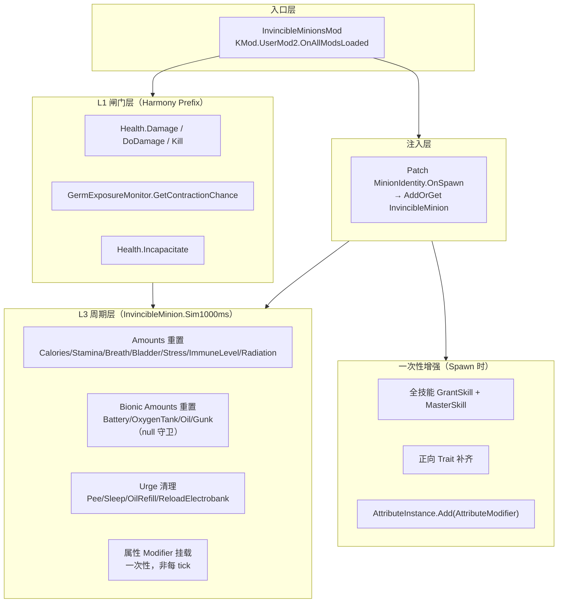

# 无敌小人（Invincible Minions）实现方案 v2

> 游戏：ONI `F:\SteamLibrary\steamapps\common\OxygenNotIncluded`（Unity 6000.3.5f2，`Assembly-CSharp.dll` 17,674 类型）
> **本文所有类名 / 字段 / 方法名均经 dll 元数据实测**（`dnfile` 解析 TypeDef / Field / Method 表），非记忆。
> v1 见 `实现计划.md`；v2 覆盖 v1 全部内容并大幅扩展。

---

## 1. 需求确认（v2 相比 v1 的增量）

| # | 需求 | 状态 |
|---|---|---|
| R1 | 不死、不伤、不失能 | v1 已有 |
| R2 | 不饿、不憋、不窒息、不冻/烫、不辐射、不生病 | v1 已有 |
| R3 | **不用上厕所** | v2 新增 |
| R4 | **不用睡觉** | v2 新增 |
| R5 | **全技能（含 Bionic 技能，装 DLC 后自动生效）** | v2 新增 |
| R6 | **全属性 1000000** | v2 新增（有分类陷阱，见 §5） |
| R7 | **只有好特质** | v2 新增 |
| R8 | 全队生效 | v1 已定（全队） |
| R9 | Spaced Out 已装 + Bionic 后续安装 → 必须兼容 | v2 新增约束 |

---

## 2. 模块架构



**分层理由**：闸门层只管「不会再死」；周期层管「状态永远良好」；一次性层管「变强」。三类互不依赖，任何一层可以单独关掉（配置开关矩阵）。

---

## 3. 新增需求的真实 API（全部实测）

### R3 不用上厕所
| 目标 | 真实载体 |
|---|---|
| 膀胱数值 | `Klei.AI.Amounts` 组件 + `Database.Amounts.Bladder`，重置到 `GetMin()` |
| 厕所状态机 | `ToiletMonitor`（`satisfied` / `unsatisfied`） |
| 如厕冲动 | `Database.Urges.Pee`、`ChoreConsumer.RemoveUrge(urge)` / `HasUrge(urge)`（实测存在） |

→ 双保险：Amounts 归零 + 清 `Pee` urge。

### R4 不用睡觉
| 目标 | 真实载体 |
|---|---|
| 体力 | `Database.Amounts.Stamina` → `GetMax()` |
| 睡眠状态机 | `SleepChoreMonitor`（`passingout` / `sleeponfloor` / `bedassigned`）、`StaminaMonitor`（`sleepy`） |
| 睡眠冲动 | `Database.Urges.Sleep` → `ChoreConsumer.RemoveUrge` |
| Bionic 充电睡眠 | `BionicBedTimeMonitor`（`bedTime` / `notAllowed`）、`Database.Amounts.BionicInternalBattery` |

### R5 全技能
| 目标 | 真实载体（实测） |
|---|---|
| 技能资源 | `Database.Skills` **静态字段 53 个**：`Mining1..4`、`Building1..3`、`Farming1..3`、`Ranching1..2`、`Researching1..4`、`AtomicResearch`、`SpaceResearch`、`Astronomy`、`RocketPiloting1..2`、`Cooking1..3`、`Arting1..3`、`Hauling1..2`、`ThermalSuits`、`Suits1`、`Technicals1..2`、`Engineering1`、`Basekeeping1..2`、`Pyrotechnics`、`Astronauting1..2`、`Medicine1..3`、`Swimming1..2`、`BionicsA1..D2`（8 个） |
| 授予/掌握 | `MinionResume.GrantSkill(...)`、`MasterSkill(...)`、`ForceAddSkillPoint()`、`SetAptitude(...)` |

**实现方式（不硬编码 53 个 id）**：反射遍历 `typeof(Database.Skills).GetFields(Public|Static)` → 每个字段值是 `Skill`（`Resource`，取 `.Id`）→ `resume.GrantSkill(id)` + `MasterSkill(id)`。
- 好处：Bionic DLC 装上后，`BionicsA1..D2` 自动纳入，不需要改代码。
- 守卫：每个技能 `try/catch`，DLC 未装时 `Skill.requiredDlcIds` 校验失败不会中断整批。

### R6 全属性 1000000
| 目标 | 真实载体（实测） |
|---|---|
| 属性实例 | `Klei.AI.AttributeInstance`：字段 `Attribute`、`Modifiers`；方法 `GetBaseValue / GetTotalValue / Add / Remove / ClearModifiers` |
| 加成载体 | `Klei.AI.AttributeModifier`：`ctor(AttributeId, Value, Description)`、`IsMultiplier`、`SetValue` |
| 等级路径（备选） | `Klei.AI.AttributeLevels.SetLevel(attribute, level)`，受 `maxAttributeLevel` 限制（等级上限，通常是 20）→ **不适合 1000000** |

**结论**：走 `AttributeInstance.Add(new AttributeModifier(attr.Id, 1000000f, "无敌"))`，不动等级，不写存档。
⚠ 陷阱见 §5——不是所有属性都越大越好。

### R7 只有好特质
| 目标 | 真实载体（实测） |
|---|---|
| 特质组件 | `Klei.AI.Traits`：`TraitList`、`Add(Trait)`、`Remove(Trait)`、`HasTrait`、`Clear` |
| 特质对象 | `Klei.AI.Trait`：`PositiveTrait`（bool）、`ValidStarterTrait`、`Rating`、`disabledChoreGroups`、`requiredDlcIds`、`AddTo / RemoveFrom` |
| 打印生成 | `MinionStartingStats`：字段 `Traits`、`stressTrait`、`joyTrait`、`congenitaltrait`；方法 `GenerateTraits()`、`ApplyTraits(...)`、`AreTraitsMutuallyExclusive(...)` |

**两条路径**：
- **P1（基线，确定可行）**：Harmony Postfix 拦 `MinionStartingStats.GenerateTraits` → 遍历 `stats.Traits`，把 `PositiveTrait == false` 的全删掉 → 保证打印出来的小人没有负面特质。
- **P2（增强，需运行时确认枚举源）**：补齐所有正向特质。`Db` 的字段表里**没有** `Traits` 字段（实测），所以「全部正向特质」的枚举源需在运行时定位（`Db.Get()` 的属性表 / `TraitSet` 实例）。实现时先探一次，取不到就降级为 P1。

### R8/R9 DLC 兼容
| 目标 | 真实载体（实测） |
|---|---|
| DLC 判定 | `SaveLoader.Instance.GameInfo.dlcIds`（`GameInfo` 字段 `dlcIds`、`dlcId`、`IsCompatableWithCurrentDlcConfiguration`） |
| Bionic 数值条 | `Database.Amounts.BionicInternalBattery`、`BionicOxygenTank`、`BionicOil`、`BionicGunk` |
| Bionic 状态机 | `BionicBatteryMonitor`、`BionicOxygenTankMonitor`、`BionicOilMonitor`、`BionicMicrochargeMonitor`→`BionicMicrochipMonitor`、`BionicSuffocationMonitor`、`BionicWaterDamageMonitor`、`BionicBedTimeMonitor`、`BionicUpgradesMonitor` |
| Bionic 技能 | `Database.Skills.BionicsA1..D2` |

**兼容策略**：`Database.Amounts.*` 的字段在 dll 里始终存在，**未装 DLC 时其值为 null**（不是编译错误）。所以：
```csharp
// 统一守卫，不需要 #if
Amount a = Database.Amounts.BionicOil;
if (a != null) amounts.SetValue(a, GetMaxFor(a));
```
`Bionic*Monitor` 类同理——只在 `InvincibleMinion` 里用 `gameObject.GetComponent<BionicOilMonitor>()`（返回 null 就跳过），**不要** 用 `[HarmonyPatch(typeof(BionicOilMonitor))]` 硬引用（未装 DLC 时类型解析可能失败）。

---

## 4. 属性重置总表（L3 每 0.5 秒）

| 数值条 | 目标 | 说明 |
|---|---|---|
| `Calories` | `GetMax()` | 不饿死 |
| `Stamina` | `GetMax()` | 不困倒（R4） |
| `Breath` | `GetMax()` | 不窒息 |
| `Bladder` | `GetMin()` | 不上厕所（R3） |
| `Stress` | `GetMin()` | 不崩溃 |
| `ImmuneLevel` | `GetMax()` | 不生病 |
| `RadiationBalance` | `GetMin()` | 不得辐射病 |
| `Toxicity` | `GetMin()` | DLC 毒素 |
| `HitPoints` | `GetMax()` | 血量兜底 |
| `BionicInternalBattery` | `GetMax()` | Bionic 电量（null 守卫） |
| `BionicOxygenTank` | `GetMax()` | Bionic 氧气罐 |
| `BionicOil` | `GetMax()` | Bionic 机油 |
| `BionicGunk` | `GetMin()` | Bionic 垃圾 |
| `ThermalConductivityBarrier` | — | 属属性，非数值条，见 §5 |

---

## 5. ⚠ 关键设计判断：不是所有属性都该设 1000000

`Database.Attributes` 里有 44 个属性，**其中若干是「越小越好」**。全部设 1000000 会造成反向效果，这是需求里没有说清、但直接照做会翻车的地方：

### A. 正向（越大越好）→ 设 1000000
`Construction`、`Digging`、`Machinery`、`Athletics`、`Learning`、`Cooking`、`Caring`、`Strength`、`Art`、`Botanist`、`Ranching`、`LifeSupport`、`Toggle`、`PowerTinker`、`FarmTinker`、`SpaceNavigation`、`Immunity`、`GermResistance`、`Insulation`、`Luminescence`、`Decor`、`FoodQuality`、`GeneratorOutput`、`MachinerySpeed`、`RadiationResistance`、`RadiationRecovery`、`MaxUnderwaterTravelCost`、`ToiletEfficiency`、`TransitTubeTravelSpeed`、`DiseaseCureSpeed`、`DoctoredLevel`、`CarryAmount`、`QualityOfLife`、`ScaldingThreshold`、`ScoldingThreshold`

### B. 反向（越小越好）→ 设 0
| 属性 | 1000000 时的后果 | 应设 |
|---|---|---|
| `AirConsumptionRate` | 耗氧率暴涨，瞬间吸干房间 | `0` |
| `DecorExpectation` | 装饰期望爆表，永远不满足 → 持续掉心情 | `0` |
| `FoodExpectation` | 食物期望爆表 | `0` |
| `QualityOfLifeExpectation` | 生活品质期望爆表 | `0` |
| `RoomTemperaturePreference` | 偏好温度错乱 | 不动（保持默认） |

### C. 结构性（设大值会崩 UI / 内存）→ 排除
| 属性 | 原因 |
|---|---|
| `BionicBoosterSlots` | 槽位数，1000000 个槽会渲染爆表 |
| `BionicBatteryCountCapacity` | 电池容量槽数 |
| `ThermalConductivityBarrier` | 导热屏障，设大会让小人变成热绝缘体（可接受但需你确认） |

**方案**：建一张「属性白名单/黑名单表」，白名单设 1000000，黑名单设 0，未列出的一律不动。表在代码里是常量，方便你后续增删。

---

## 6. 开关矩阵（配置）

`mod_info.yaml` 旁放 `InvincibleConfig.json`（或 mod 设置界面，第一版用 json）：
```json
{
  "immortal": true,          // R1 不死不伤
  "physiology": true,        // R2 数值条
  "noToilet": true,          // R3
  "noSleep": true,           // R4
  "allSkills": true,         // R5
  "maxAttributes": true,     // R6
  "goodTraitsOnly": true,    // R7
  "bionicCompat": true,      // R9（DLC 未装时自动空转）
  "debugLog": false
}
```
每个开关对应一个 `if`，任何一项出问题可以单独关掉，不用重装 mod。

---

## 7. 分波实施

### Wave 1 — 骨架 + 不死（R1/R2 核心）
1. `mod.yaml` / `mod_info.yaml` / `build.bat`（csc 编译到 `mods\Local\InvincibleMinions\`）
2. `InvincibleMinionsMod.cs`：`OnAllModsLoaded` 里 `new Harmony("Wenxing.InvincibleMinions").PatchAll(...)`
3. `HealthPatch.cs`：Prefix 拦 `Damage` / `DoDamage` / `Kill`
4. `InvincibleMinion.cs`：Spawn 注入 + `Sim1000ms` 重置 §4 前 9 项
5. **验证**：`build.bat` exit 0 → jar 产物存在 → 启动游戏看 `Player.log` 无 `HarmonyException` → 进游戏实测血量/卡路里/呼吸

### Wave 2 — 环境与疾病（R2 完整 + R3/R4）
6. `GermPatch.cs`（`GetContractionChance` → 0）
7. 温度/辐射/窒息阈值字段（`ExternalTemperatureMonitor`、`RadiationMonitor`、`OxygenBreather`）
8. `Urge` 清理（`Pee` / `Sleep`）
9. **验证**：无氧房间不窒息；极热/极冷区不掉血；病菌区不感染；小人不上厕所、不倒地睡

### Wave 3 — 增强（R5/R6/R7）
10. `SkillEnhancer.cs`：反射枚举 `Database.Skills` → `GrantSkill` + `MasterSkill`
11. `AttributeEnhancer.cs`：`AttributeInstance.Add(AttributeModifier)`，按 §5 白/黑名单
12. `TraitEnhancer.cs`：P1（Postfix 过滤负面特质）+ P2（若枚举源可用则补齐正向）
13. **验证**：打印的小人技能全亮；属性面板显示 1000000；特质列表无负面

### Wave 4 — DLC 兼容（R9）
14. Bionic Amounts 重置（null 守卫）
15. Bionic Monitor 的 `GetComponent` 判空处理
16. `SaveLoader.Instance.GameInfo.dlcIds` 判定（可选，用于日志）
17. **验证**：装 Bionic DLC 后新建存档 → Bionic 小人不掉电、不缺水、不窒息

---

## 8. 验证能力边界（诚实说明）

| 我能自动验的 | 需要你实测的 |
|---|---|
| `csc.exe` 编译 exit code / 产物存在 | 游戏内血量是否真的不掉 |
| `mod.yaml` / `mod_info.yaml` 格式（对比本机现有 20+ 个模组） | 技能面板是否全亮 |
| `Player.log` 里 mod 加载成功、无 Harmony 异常 | 属性面板数值是否为 1000000 |
| dll 里类型/字段存在性（已用 dnfile 实测） | Bionic DLC 装上后的实际表现 |

**我不会声称"已通过游戏测试"**——那需要我操作游戏，做不到。

---

## 9. 风险与降级

| 风险 | 降级方案 |
|---|---|
| `Amounts.SetValue` 签名不符 | 退回 `GetComponent<Amounts>()` 遍历 + `AmountInstance.SetValue`；再不行直接写 `AmountInstance.value` 字段 |
| `AttributeInstance.Add` 需要不同构造 | 直接往 `Modifiers`（public List 字段）里 `Add(new AttributeModifier(...))` |
| 正向特质枚举源找不到 | 只用 P1（删负面特质），保证「只有好特质」的否定面 |
| 1000000 导致移动速度异常 / 卡顿 | 白名单里的 `Athletics` 单独降到 100（可配） |
| Harmony 与其他 mod 冲突 | 加 `[HarmonyPriority(Priority.First)]`，并在日志里打印 patch 冲突 |
| `MasterSkill` 对 Bionic 技能失败 | 逐技能 try/catch，失败只记日志不中断 |

---

## 10. 需要你确认的两点（其余我已按上表定稿）

1. **§5 的属性分类**：`Athletics` 设 1000000 会让小人移动速度极快，可能出现穿墙感/卡顿；建议降到 100。你接受 1000000 还是 100？
2. **`ThermalConductivityBarrier`（导热屏障）**：设大会让小人几乎不导温。要不要设？我默认**不设**（保持原值）。

确认后我直接从 Wave 1 开始写代码 + 编译 + 部署到 `mods\Local\InvincibleMinions\`。
