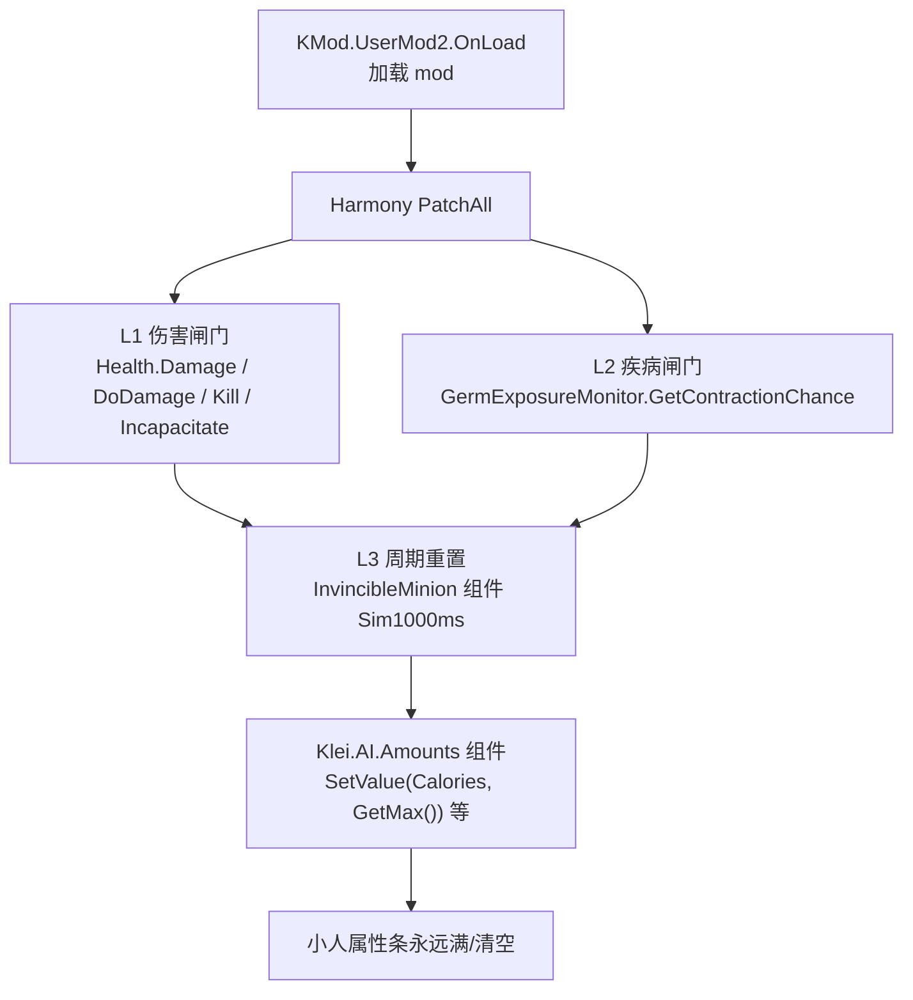

# 无敌小人（Invincible Minions）实现计划

> 目标游戏：Oxygen Not Included（本机 `F:\SteamLibrary\steamapps\common\OxygenNotIncluded`，Unity 6000.3.5f2，Managed/Assembly-CSharp.dll 实测 17674 个类型）
> 本文所有类名 / 字段名均来自 **对该 dll 的元数据实测**（`dnfile` 解析 TypeDef/Field/Method 表），不是凭记忆写的。
> 标 ⚠ 的是与网上老教程（U34 时代）不一致的新版事实。

---

## 1. 需求提炼

**目标**：让打印出来的小人不会死、不会受伤、不会生病、不会饿死/憋死/窒息/冻伤烫伤/辐射致死。

**非目标**（第一版不做，模块化留给后续开关）：
- 不改变建造/挖掘速度、不复制造物、不无限资源
- 不加 UI 界面（用 mod 配置项或改常量控制）

**"无敌"的判定边界**：小人掉血不再可能；即使环境持续伤害也不会进入「失能 → 死亡」链路。

---

## 2. 技术选型（已核实）

| 项 | 选择 | 依据 |
|---|---|---|
| 运行时 | .NET Framework 4.7.1（游戏 Mono） | Assembly-CSharp 目标框架 |
| 补丁库 | Harmony 2，**游戏自带** `Managed\0Harmony.dll` | 文件实测存在 |
| mod 入口 | `KMod.UserMod2` 子类，重写 `OnLoad` / `OnAllModsLoaded` | 元数据确认这两个方法存在 |
| 编译 | 本机 `C:\Windows\Microsoft.NET\Framework64\v4.0.30319\csc.exe`（**无 dotnet SDK / 无 VS**，已实测） | 直接 `/r:` 引用游戏 dll，不需要 MSBuild |
| 语法约束 | csc v4.0.30319 = **C# 5**：不能用 `$""`、`=>` 表达式体、`nameof`、`out var` | 编译器版本限制 |
| 部署 | `%USERPROFILE%\Documents\Klei\OxygenNotIncluded\mods\Local\InvincibleMinions\` | 现有 mods 目录实测无 Local，需新建 |

⚠ 网上常见写法 `public override void OnLoad(Harmony harmony)`：新版 `KMod.UserMod2` 只有 `OnLoad` / `OnAllModsLoaded` 方法（无参重载需编译期确认，第一版用 `OnAllModsLoaded` 里 `new Harmony("...").PatchAll()` 最稳，避免签名不匹配）。

---

## 3. 架构



三层分工：**L1 切断死亡入口**（任何伤害不再生效）→ **L2 切断疾病感染入口** → **L3 兜住所有"非伤害型"死法**（饿死、憋死、冻死、辐射病、失能流血）。

单靠 L1 不够：窒息/饥饿不经过 `Health.Damage`，走各自 Monitor 的状态机；单靠 L3 不够：一次大额伤害可能在两次 tick 之间就打死。所以两层都必要。

---

## 4. 属性清单（**请在此增删 / 打勾**）

### A. 生命与死亡（核心，建议必选）

| # | 属性 | 真实载体（已验证） | 目标值 | 手段 |
|---|---|---|---|---|
| A1 | 生命值 | `Health.hitPoints` / `maxHitPoints`（背后 `Amounts.HitPoints`） | = `maxHitPoints` | L1 + L3 `AmountInstance.SetValue(GetMax())` |
| A2 | 受伤 | `Health.Damage(...)`、`Health.DoDamage(...)` | 不生效 | Harmony Prefix `return false` |
| A3 | 死亡 | `Health.Kill()` | 不触发 | L1（`Damage` 被拦后自然不触发） |
| A4 | 失能/昏迷 | `Health.canBeIncapacitated`（字段，bool） | `false` | 反射置字段 |
| A5 | 失能流血致死 | `IncapacitationMonitor.die` / `bleedOutStamina` | 不触发 | A4 + A1 |

### B. 生理条（`Klei.AI.Amounts` 组件的 `AmountInstance`）

统一手段：`amounts.SetValue(Database.Amounts.X, 目标值)`，目标值取 `GetMax()` / `GetMin()`，**不硬编码数字**（`AmountInstance` 已有 `GetMin`/`GetMax` 方法，实测存在）。

| # | 属性条 | `Database.Amounts` 字段（实测） | 目标 | 归零/拉满理由 |
|---|---|---|---|---|
| B1 | 卡路里 | `Calories` | `GetMax()` | 不饿死、不触发 `RationMonitor` |
| B2 | 体力 | `Stamina` | `GetMax()` | 不因困倦倒地（`SleepChoreMonitor.passingout`） |
| B3 | 呼吸 | `Breath` | `GetMax()` | 不触发窒息（`SuffocationMonitor`） |
| B4 | 膀胱 | `Bladder` | `GetMin()` | 不尿裤子（`ToiletMonitor` / `UrgeMonitor`） |
| B5 | 压力 | `Stress` | `GetMin()` | 不精神崩溃（`StressMonitor`） |
| B6 | 免疫力 | `ImmuneLevel` | `GetMax()` | 不生病 |
| B7 | 辐射平衡 | `RadiationBalance` | `GetMin()` | 不得辐射病（`RadiationMonitor.isSick`） |
| B8 | 体温 | `Temperature` | （可选）舒适区 | ⚠ 新版体温不是单一 amount，见 C3 |
| B9 | 毒素 | `Toxicity` | `GetMin()` | 新版 DLC 属性 |

⚠ **`Calories` / `Stamina` / `Bladder` / `Stress` 在 dll 里不是组件类**，而是 `Database.Amounts` 的静态 `Amount` 定义（实测 TypeDef 中无 `Calories` 类）。老教程写 `GetComponent<Calories>()` 在新版**编译不过**。

### C. 环境伤害（Monitor 类，实测存在）

| # | 属性 | 真实字段（实测） | 目标 | 手段 |
|---|---|---|---|---|
| C1 | 缺氧阈值 | `OxygenBreather.noOxygenThreshold`、`lowOxygenThreshold` | `0` | L3 改字段（配合 B3） |
| C2 | 窒息倒计时 | `SuffocationMonitor.timeUntilDeath` | 不归零 | B3 拉满 |
| C3 | 冷/热阈值 | `ExternalTemperatureMonitor.EXTERNAL_COLD_THRESHOLD`、`EXTERNAL_WARM_THRESHOLD` | 极端化（冷到极点 / 热到极点） | L3 改字段 |
| C4 | 低温免疫 | `ColdImmunityMonitor`（`coldCountdown`） | 不进入 | C3 |
| C5 | 高温免疫 | `HeatImmunityMonitor`（`heatCountdown`） | 不进入 | C3 |
| C6 | 烫伤 | `ScaldingMonitor.SCALDING_DAMAGE_AMOUNT`、`TakeScaldDamage` | 0 伤害 | A2 已拦；可选把常量改 0 |
| C7 | 辐射暴露 | `RadiationMonitor.radiationExposure`、`currentExposurePerCycle` | 0 | L3 置 0 + B7 |
| C8 | 气压伤害 | `PressureMonitor`（`IsImmuneToPressure` 判定）、`PressureVulnerable.pressureState` | 免疫 | 无需改（A1 兜底） |
| C9 | 溺水 | `DrowningMonitor` | 不触发 | B3 + C1 |
| C10 | 坠落 | `Faller` | 无伤害 | A2 |

### D. 疾病（新版无 `ImmuneSystem` 组件）

| # | 属性 | 真实载体（实测） | 目标 | 手段 |
|---|---|---|---|---|
| D1 | 病菌感染概率 | `GermExposureMonitor.GetContractionChance(...)` | 返回 0 | Harmony Prefix（返回值替换） |
| D2 | 病种 | `Klei.AI.Sickness.Infect(...)`、`Cure(...)`、`fatalityDuration` | 不感染 | D1；可选 Prefix 拦 `Infect` |
| D3 | 疾病状态机 | `SicknessMonitor`（`healthy`/`sick`/`post`） | 保持 healthy | D1 |
| D4 | 辐射病 | `Klei.AI.RadiationSickness`（`ID`） | 不感染 | B7 + C7 |

⚠ **`ImmuneSystem` 类在 dll 里不存在**（实测 TypeDef 无此类）。免疫 = `Amounts.ImmuneLevel` + `Attributes.Immunity` + `GermExposureMonitor`。

### E. 卫生与伤口

| # | 属性 | 真实载体 | 目标 | 手段 |
|---|---|---|---|---|
| E1 | 污垢 | `HygieneMonitor.dirtiness` | 0 | L3 置 0（可选） |
| E2 | 伤口 | `WoundMonitor`（`healthy`/`wounded`） | healthy | A2 后自然 |
| E3 | 生物油/垃圾（Bionic DLC） | `GunkMonitor.GUNK_CAPACITY`、`gunkValueChangedSignal` | 不累积 | 可选：仅当装了 Bionic DLC |

### F. 可选增强（默认关闭，按需打开）

| # | 效果 | 真实载体 |
|---|---|---|
| F1 | 不耗氧 | `Database.Attributes.AirConsumptionRate` → 0 |
| F2 | 属性拉满（跑得快、干得快） | `Klei.AI.AttributeLevels.SetLevel(...)`：`Athletics`/`Strength`/`Machinery`/`Construction`/`Digging`… (见 `Database.Attributes`) |
| F3 | 免疫气压伤害 | `Database.Attributes.Insulation`、`ScaldingThreshold`、`ScoldingThreshold` |
| F4 | 不吃饭 | B1 已覆盖（卡路里恒满） |
| F5 | 辐射抗性 | `Database.Attributes.RadiationResistance` → 高 |

---

## 5. 文件结构

```
无敌小人/
├─ 实现计划.md              ← 本文件
├─ src/
│  ├─ InvincibleMinionsMod.cs      mod 入口（KMod.UserMod2）
│  ├─ Patches/
│  │  ├─ HealthPatch.cs            L1：Damage / DoDamage / Kill / Incapacitate
│  │  ├─ GermPatch.cs              L2：GetContractionChance
│  │  └─ SicknessPatch.cs          （可选）Sickness.Infect
│  └─ Components/
│     └─ InvincibleMinion.cs       L3：周期重置 AmountInstance
├─ build.bat                       调用 csc.exe 编译到 mods\Local\
├─ mod.yaml                        title / description / staticID
└─ mod_info.yaml                   supportedContent / minimumSupportedBuild / APIVersion
```

`mod.yaml` / `mod_info.yaml` 格式已从本机现有模组实测确认：

```yaml
# mod.yaml
title: 无敌小人
description: 小人不会受伤、生病、饿死、窒息
staticID: Wenxing.InvincibleMinions
```
```yaml
# mod_info.yaml
supportedContent: ALL
minimumSupportedBuild: 525812   # 保守值；若游戏提示不支持，改为 mod 界面显示的 build 号
version: 1.0.0
APIVersion: 2
```

---

## 6. 实施步骤

1. 建 `mod.yaml` / `mod_info.yaml` / 目录骨架
2. 写 `InvincibleMinionsMod.cs`：`OnAllModsLoaded` 里 `new Harmony("Wenxing.InvincibleMinions").PatchAll(Assembly.GetExecutingAssembly())`
3. 写 L1 `HealthPatch`：Prefix 无参 + `__instance`，`Damage`/`DoDamage` 一律 `return false`；`Kill` 同
4. 写 L3 `InvincibleMinion`：挂在每个 duplicant 上（`OnSpawn` 时 `gameObject.AddOrGet<InvincibleMinion>()`，或用 `[HarmonyPatch(typeof(MinionIdentity), "OnSpawn")]` Postfix 注入），`Sim1000ms` 里按 B 段表格重置
5. `build.bat` 编译 + 复制到 `mods\Local\InvincibleMinions\`
6. 进游戏 → 模组列表确认启用 → 打印小人 → 逐项验证（见 §7）
7. 按用户增删结果调整开关

---

## 7. 验证清单（每项都要在游戏里实测，不看代码推断）

| 验证项 | 操作 | 期望 |
|---|---|---|
| V1 mod 加载 | 启动游戏 | mod 列表可见且无报错；Player.log 无 Harmony 异常 |
| V2 受伤免疫 | 用「受伤」调试或让小人被高温/坠落击中 | 血量不变 |
| V3 窒息免疫 | 把小人关进无氧房间 | 不出现窒息状态、不倒计时 |
| V4 饥饿免疫 | 断粮 10 周期 | 卡路里条不动、无饥饿状态 |
| V5 疾病免疫 | 让小人接触病菌/辐射 | 不感染、`SicknessMonitor` 保持 healthy |
| V6 温度免疫 | 丢进极热/极冷区 | 无冻伤/烫伤状态，血量不掉 |
| V7 失能免疫 | 强制扣血到 0 附近 | 不进入失能、不流血 |

---

## 8. 已知风险

1. **Harmony Prefix 签名兼容**：`Health.Damage` 参数表未解析（元数据只有名字），Prefix 一律不声明原方法参数，只用 `__instance`，避免 `HarmonyException`。
2. **`Amounts.SetValue` 重载**：`Klei.AI.Amounts` 有 `GetValue/SetValue/Add/Remove`，签名需编译期确认；备选路径是 `Klei.AI.AmountInstance.SetValue`（已确认存在）或直接写 `value` 字段。
3. **C# 5 限制**：不能用现代语法，代码要写老风格。
4. **DLC 差异**：`Database.Amounts` 里 `BionicOxygenTank`/`BionicOil`/`BionicGunk` 属 Bionic DLC；未装 DLC 时这些 Amount 可能不存在 → 逐项 `try/catch` 或按 `DlcManager` 判定。
5. **mod 兼容**：其他 mod 若也 patch `Health.Damage`，需用 `HarmonyPriority` 协调（第一版不处理）。

---

## 9. 待你确认（决定我下一步写哪一版代码）

- [ ] 上面的属性清单要不要全上？还是先只做 **A + B**（不死 + 不饿不憋不病），环境类 C/D 留开关？
- [ ] F 段「属性拉满跑得快」要不要？
- [ ] 是否需要「队友全队无敌」还是「只对指定小人」？（第一版默认全队）
- [ ] 是否装了 Spaced Out / Bionic DLC？（影响 B9 / E3 的字段是否需要）
